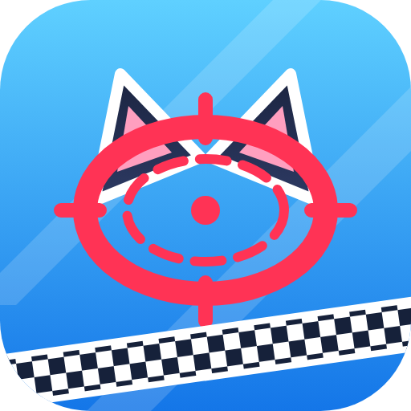
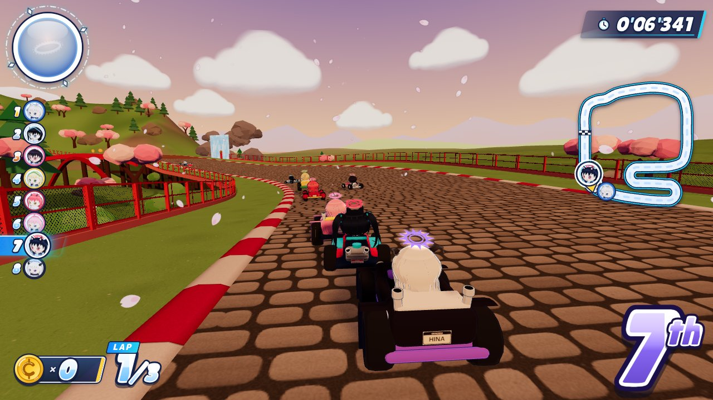
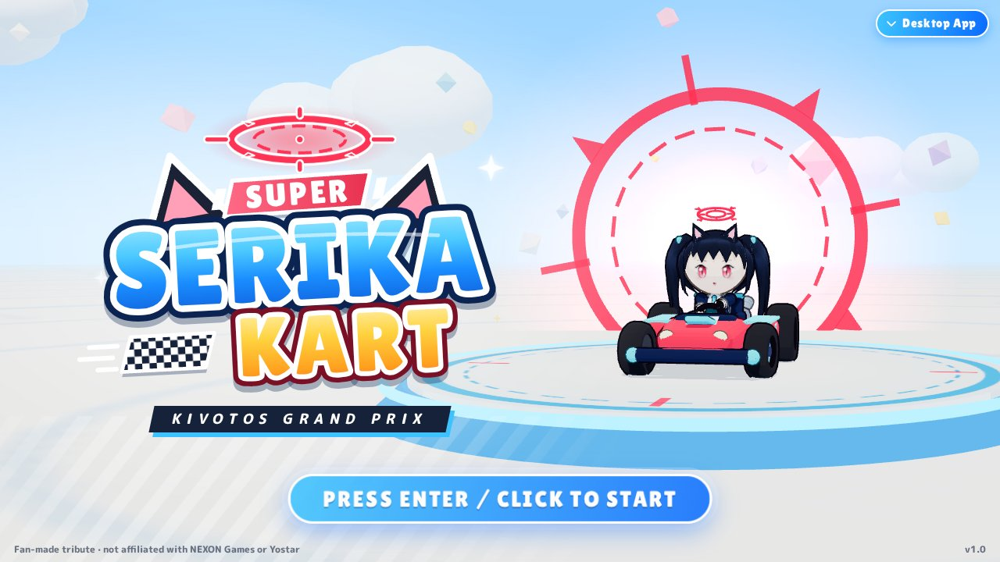
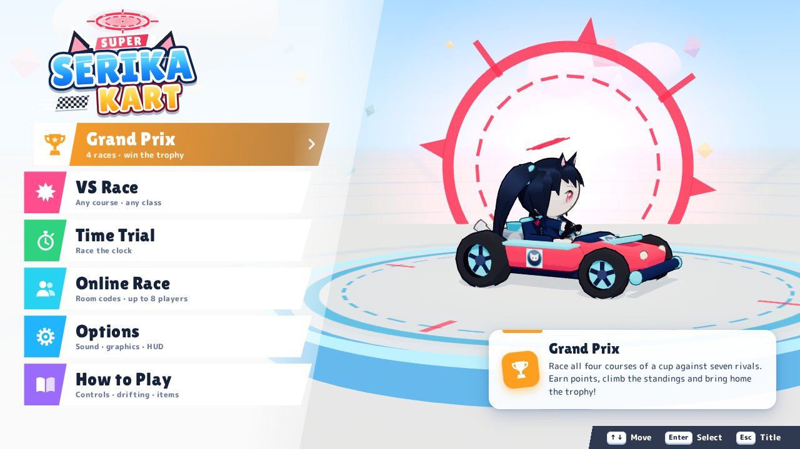

<div align="center">



# Super Serika Kart

**A Mario-Kart-style 3D kart racer starring Serika and the students of Kivotos.**
Drift, boost, throw ramen, and race your friends online — in the browser, on your phone, or as a desktop app.

[**▶ Play now at kart.serika.dev**](https://kart.serika.dev) &nbsp;·&nbsp; [**⬇ Download the desktop app**](https://github.com/Pikachubolk/super-serika-kart/releases/latest)



</div>

---

## Contents

- [Features](#features)
- [Ways to play](#ways-to-play)
- [Controls](#controls)
- [Racers](#racers)
- [Courses](#courses)
- [Items](#items)
- [Driving techniques](#driving-techniques)
- [Online multiplayer](#online-multiplayer)
- [Soundtrack](#soundtrack)
- [Options](#options)
- [Development](#development)
- [Deployment](#deployment)
- [Project structure](#project-structure)
- [Credits & disclaimer](#credits--disclaimer)

## Features

- **8 racers, 8 courses, 2 cups**: Grand Prix, VS Race and Time Trial across 50cc / 100cc / 150cc / 200cc.
- **Proper kart feel**: drift mini-turbos (blue → orange → purple), rocket starts, ramp tricks, dash panels and Credits that raise your top speed.
- **15 items**, from energy drinks and spilled ramen to homing drone missiles and Arona's Shittim Tablet.
- **Online multiplayer** for up to 8 players with room codes, multi-race **tournaments** with Grand Prix points, CPU fill-ins, automatic reconnects, and a relay that works on school and office networks.
- **Plays everywhere**: keyboard, any standard controller, or on-screen touch controls (stick, pads or tilt steering) on phones and tablets.
- **Installable**: a PWA that works offline after the first visit, plus a desktop app for Windows, macOS and Linux.
- **23-track original soundtrack**, synthesized live in the browser, with a Sound Test jukebox.
- **100% procedural**: every model, course, texture, sound and song is generated in code. There are no image, model or audio files in the game.

<p align="center">
  
  
</p>

## Ways to play

| | How | Notes |
|---|---|---|
| **Browser** | Open [kart.serika.dev](https://kart.serika.dev) | Chrome, Edge, Firefox and Safari. Needs WebGL. |
| **Phone / tablet** | Open the site, then **Install App** (Android) or **Share → Add to Home Screen** (iPhone/iPad) | Plays in landscape. The first tap goes fullscreen. |
| **Desktop app** | [Download](https://github.com/Pikachubolk/super-serika-kart/releases/latest) for your system | Smoother on laptops: it uses the dedicated graphics card and is never throttled in the background. Single-player works offline. |

**Desktop app downloads**

| System | File |
|---|---|
| Windows (installer) | `SuperSerikaKart-<version>-win-x64.exe` |
| Windows (no install) | `SuperSerikaKart-<version>-portable.exe` |
| macOS (Apple Silicon) | `SuperSerikaKart-<version>-mac-arm64.dmg` |
| Linux | `SuperSerikaKart-<version>-linux-x86_64.AppImage` |

The builds are not code-signed, so your system will warn you the first time:

- **Windows**: "Windows protected your PC" → **More info** → **Run anyway**.
- **macOS**: right-click the app → **Open** → **Open**.
- **Linux**: make it executable first: `chmod +x SuperSerikaKart-*.AppImage`.

Desktop app shortcuts: **F11** or **Alt+Enter** toggles fullscreen.

## Controls

| Action | Keyboard | Controller | Touch |
|---|---|---|---|
| Accelerate | `W` / `↑` | A | Automatic (AUTO GAS) or GAS |
| Brake / Reverse | `S` / `↓` | B / LT | BRAKE |
| Steer | `A` `D` / `←` `→` | Left stick / D-pad | Left thumb: stick, pads or tilt |
| Drift / Hop | `Space` / `Shift` | RB / RT | Hold DRIFT |
| Use item | `E` `J` `X` `L` | X / LB | ITEM |
| Look back | `Q` / `C` | Y | Look-back button |
| Pause | `Esc` / `P` | Start | II (top of screen) |

Menus: arrow keys or WASD to move, `Enter` / `Space` to select, `Esc` / `Backspace` to go back. Mouse and touch work everywhere. Controllers (Xbox, PlayStation, Switch Pro…) are plug and play: press a button to wake one up.

## Racers

Stats run from 1 to 5.

| Racer | School | Speed | Accel | Weight | Handling | Traction | Kart |
|---|---|:-:|:-:|:-:|:-:|:-:|---|
| **Serika** | Abydos | 3.5 | 3.5 | 3 | 3.5 | 3.5 | Standard — the all-rounder |
| **Shiroko** | Abydos | 4 | 3 | 3 | 4 | 3 | Sport |
| **Hoshino** | Abydos | 3.5 | 2.5 | 4.5 | 2.5 | 4 | Heavy |
| **Nonomi** | Abydos | 4.5 | 2 | 5 | 2 | 3.5 | Heavy |
| **Ayane** | Abydos | 2.5 | 5 | 1.5 | 4.5 | 3 | Light |
| **Aru** | Gehenna | 4 | 3 | 3.5 | 3 | 3 | Luxury |
| **Arisu** | Millennium | 3 | 4.5 | 2 | 4 | 3.5 | Light |
| **Hina** | Gehenna | 5 | 1.5 | 4.5 | 2 | 4 | Heavy |

Heavy racers barely budge when bumped; light racers accelerate faster.

## Courses

**Credit Cup**

1. **Abydos Desert Circuit**: sand-swept streets around Abydos High. Watch the dunes!
2. **Shibaseki Ramen Street**: sunset city blocks past the best ramen shop in Kivotos.
3. **Trinity Garden Speedway**: rolling hills, rose gardens and a cathedral finish.
4. **Millennium Cyber Loop**: a neon night drive through the science school skyline.

**Pyroxene Cup**

1. **Hyakkiyako Sakura Pass**: a mountain road under a thousand torii and falling petals.
2. **Red Winter Snow Fortress**: icy corners around the Federal Academy fortress. Slippery!
3. **Gehenna Inferno Rally**: lava rivers, demon castles and zero guard rails.
4. **Arona's Sky Classroom**: a shimmering road through the clouds of the Shittim Chest.

## Items

Drive through item boxes to spin the roulette. Racers further back get stronger items. Hold **Look Back** to throw items behind you.

| Item | What it does |
|---|---|
| Energy Drink | Instant speed boost. |
| Triple Energy Drink | Three boosts in a six-pack ring. |
| Sensei's Card | Unlimited boosts for a few seconds. |
| Spilled Ramen | A slippery bowl you drop behind you. |
| Triple Ramen | Three bowls trailing behind you. |
| Ricochet Round | Fires straight ahead and bounces off walls. |
| Triple Ricochet | Three rounds orbiting your kart. |
| Drone Missile | Shiroko's drone locks on to the racer ahead of you. |
| Triple Drone Missile | Three homing missiles orbiting your kart. |
| Grenade | Lob it forward. Big boom! |
| Halo Overdrive | Your halo blazes: invincible and faster for a while. |
| Shittim Tablet | Arona zaps every rival: they drop their items and shrink. |
| Blue Seeker | A winged missile that hunts down the leader. |
| Credit Bag | +3 Credits (more Credits, more top speed). |
| Decoy Box | Looks like an item box. It is not. |

## Driving techniques

- **Drift & mini-turbo**: hold Drift while steering at speed to slide. Keep drifting to charge sparks, then release: **blue** (0.9 s) gives a short boost, **orange** (1.9 s) a strong one, **purple** (3 s) an ultra boost. Steering into the drift charges faster.
- **Rocket start**: press Accelerate just as the **2** fades during the countdown. Too early and you stall!
- **Tricks**: press Drift while flying off a ramp, and stick the landing for a boost.
- **Dash panels**: drive over the glowing chevrons for an instant burst. Boosts ignore off-road slowdown.
- **Credits**: each Credit (up to 10) adds +1% top speed. Getting hit makes you drop some.
- **Off-road and edges**: sand, grass and snow slow you down (high Traction helps). Fall off the edge and a drone carries you back.
- **Grand Prix points**: 15 · 12 · 10 · 8 · 6 · 4 · 2 · 1. The highest total after four races wins the cup.

## Online multiplayer

1. Open **Online Race**, pick a nickname and press **Create Room**.
2. Share the 6-character **room code** or the **invite link** (`https://kart.serika.dev/?join=CODE`).
3. Friends join, pick their racers and press **Ready**. The host picks the settings and starts.

**Host settings**

| Setting | Choices |
|---|---|
| Races | Single race, or a 2, 3, 4, 6 or 8-race tournament |
| Engine | 50cc · 100cc · 150cc · 200cc |
| Course | Random courses (no repeats), all courses in order, a cup, or one fixed course |
| Laps | 1–5 |
| CPU racers | On: empty seats are filled with CPUs, up to 8 racers |
| Items | On / off |

**Tournaments** score every race with Grand Prix points. After each race everyone sees the standings together, and the next race starts for all players after 20 seconds, or sooner once everybody is ready. Later races start the leader at the back of the grid.

**Joining late and dropping out**: players who join mid-race wait in the lobby and join the next race. If someone's connection drops (a phone locking, wifi hiccups), their kart is taken over by a CPU and they reconnect automatically once the page is visible again, keeping their seat and points.

**School and office networks**: all online traffic goes through a WebSocket relay on the game's own server (`wss://kart.serika.dev/ws`), so it works anywhere the website loads. The browser version, the installed PWA and the desktop app can all play together.

## Soundtrack

Every song is an original composition, written in a small music notation and synthesized live with the Web Audio API. Listen to all of them in **Options → Sound → Sound Test**.

| # | Track | Style | Plays on |
|---|---|---|---|
| 1 | Super Serika Kart! (Main Theme) | Main theme | Title screen |
| 2 | Kivotos Lounge | Bouncy shuffle | Main menu |
| 3 | Choose Your Student | Jazz funk | Character select |
| 4 | Schale Office Bossa | Bossa nova | Options, How to Play |
| 5 | Link Start! | Future funk | Online lobby |
| 6 | Serika Circuit | Circuit rock | Race mix |
| 7 | Sands of Abydos | Desert adventure | Abydos Desert Circuit |
| 8 | Shibaseki Sunset Drive | Sunset city funk | Shibaseki Ramen Street |
| 9 | Trinity Garden Bells | Orchestral bells | Trinity Garden Speedway |
| 10 | Millennium Neon Grid | Synthwave | Millennium Cyber Loop |
| 11 | Hyakkiyako Lantern Festival | Festival | Hyakkiyako Sakura Pass |
| 12 | Red Winter Parade | Winter march | Red Winter Snow Fortress |
| 13 | Gehenna Inferno Riot | Chiptune metal | Gehenna Inferno Rally |
| 14 | Arona Sky Road | Sky road | Arona's Sky Classroom |
| 15 | Drift Queen of Kivotos | Eurobeat | Race mix |
| 16 | Kivotos Highway | Trance | Race mix |
| 17 | Credit Crunch Ska | Ska punk | Race mix |
| 18 | Arona's 8-Bit Rally | 8-bit | Race mix |
| 19 | After-School Tea Time | Lo-fi | Race results |
| 20 | Road to the Kivotos Cup | Anthem | Tournament standings |
| 21 | Victory Lap! | Fanfare | Victory |
| 22 | Maybe Next Time... | Music box | Defeat |
| 23 | The Shittim Cup | Grand brass | Trophy ceremony |

**Race Music** in Options lets you keep each course's own theme, shuffle the whole race mix, or always race to one track.

## Options

| Tab | Settings |
|---|---|
| **Sound** | Master, Music, Effects, Engines and Voices volume (each slider plays a preview) · Race Music · Sound Test · Mute in Background · Mono Audio |
| **Display** | Graphics quality (high / medium / low) · HUD map (map + ranks, minimap only, ranks only, hidden) · Show FPS |
| **Controls** | Keyboard and controller reference |

Phones start on medium quality. During races the game automatically lowers the render resolution if the frame rate drops, and raises it again when there is headroom.

## Development

Requirements: **Node.js 22+** and npm.

```bash
npm install
```

```bash
npm run dev
```

The game runs at <http://localhost:5173>. For online play during development, also start the local relay (Vite forwards `/ws` to it):

```bash
npm run relay
```

| Script | What it does |
|---|---|
| `npm run dev` | Vite dev server on port 5173 |
| `npm run relay` | Online relay only, on port 8787 (used by the dev server) |
| `npm run build` | Production build into `dist/` (includes the service worker) |
| `npm start` | Production server: serves `dist/` + the relay (port 80, or `PORT`) |
| `npm run shot -- --url "/?…"` | Headless-Chrome screenshot / console harness (`tools/shot.mjs`) |
| `npm run validate-tracks` | Track geometry validator |

**Handy URLs**

| URL | Opens |
|---|---|
| `/?quickrace=abydos-desert&char=serika&cc=150&laps=3` | Straight into a race (`&autopilot=1` lets the AI drive) |
| `/?join=ABC123` | Online screen with a room code filled in |
| `/?scene=audio` | Sound test / level report debug scene |
| `/?scene=track&track=red-winter` | Course viewer (other scenes live in `src/debug/`) |
| `/?touch=1` | Force the touch controls on a desktop browser |
| `/?net=p2p` | Use peer-to-peer WebRTC (PeerJS) instead of the relay |

### Desktop app

The Electron app in `desktop/` wraps the web build.

```bash
npm run build
```

```bash
cd desktop && npm install && npm run app
```

Package it with `npm run dist:win`, `npm run dist:linux` or `npm run dist:mac` (inside `desktop/`). Installers land in `desktop/release/`.

**Releases**: push a version tag (for example `git tag v1.2.0 && git push origin v1.2.0`). [`.github/workflows/desktop.yml`](.github/workflows/desktop.yml) builds Windows, macOS and Linux and attaches them to a GitHub Release.

## Deployment

The [`Dockerfile`](Dockerfile) builds the game and runs [`server/server.mjs`](server/server.mjs), one small Node process that:

- serves `dist/` with gzip, caches hashed `/assets/*` forever, and falls back to `index.html`;
- runs the online relay on `/ws` ([`server/relay.mjs`](server/relay.mjs));
- answers `/healthz` with relay stats.

```bash
docker build -t super-serika-kart .
```

```bash
docker run -p 8080:80 super-serika-kart
```

The live site runs on Coolify, which rebuilds on every push to `main`. Any host with WebSocket support works. Put HTTPS in front of it: service workers and `wss://` need it.

## Project structure

```
src/
  main.js              entry point (game / debug scenes, PWA registration)
  core/                Game loop & screen flow, renderer, input, AudioManager
    audio/             synth instruments, sequencer, songs (songs.js, songsExtra.js), sfx, voices
  race/                race orchestration, chase camera, particles, race feedback
  entities/            karts & physics, AI drivers, item system, character / kart models
  world/               course builder, terrain, props, environment, shaders
  data/                characters, engine classes, items, course definitions
  net/                 online session, race sync, WebSocket relay client
  ui/                  HUD, menus, touch controls, portraits
  styles/              menus, HUD, touch, mobile layouts
  pwa/                 service worker template
  debug/               debug scenes (?scene=…)
server/                production server + online relay
desktop/               Electron desktop app
public/                web manifest + app icons
tools/                 screenshot harness, track validator
ARCHITECTURE.md        module contracts and internals
```

[ARCHITECTURE.md](ARCHITECTURE.md) documents every module's contract in depth: physics, tracks, items, AI, audio, online and more.

**Tech**: [Three.js](https://threejs.org) r186 · [Vite](https://vite.dev) · vanilla JavaScript ES modules · Web Audio API · [ws](https://github.com/websockets/ws) (relay) · [Electron](https://www.electronjs.org) (desktop) · [PeerJS](https://peerjs.com) (optional P2P mode)

## Credits & disclaimer

Super Serika Kart is a **non-commercial fan game**. It is **not affiliated with or endorsed by NEXON Games or Yostar**. *Blue Archive* and its characters belong to their respective owners.

All code, 3D models, courses, music and sound effects in this project are original and generated procedurally. The UI fonts ([Lilita One](https://fonts.google.com/specimen/Lilita+One) and [M PLUS Rounded 1c](https://fonts.google.com/specimen/M+PLUS+Rounded+1c)) are loaded from Google Fonts under the SIL Open Font License.

Made by [Pikachubolk](https://github.com/Pikachubolk).
